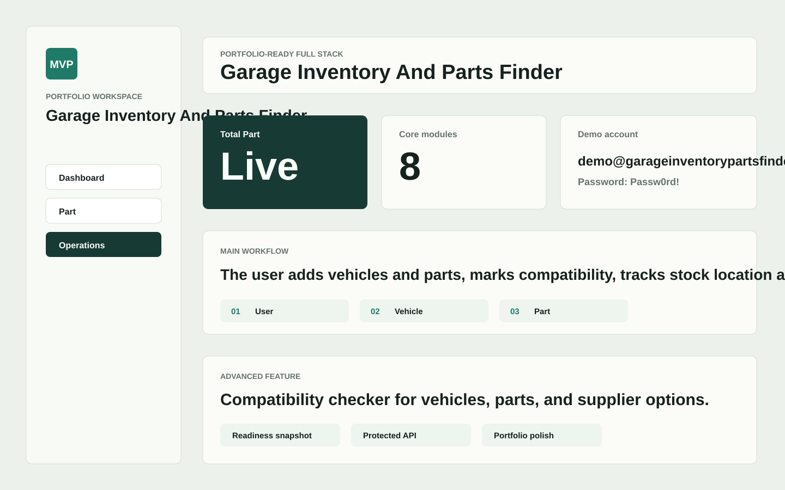

# Garage Inventory And Parts Finder

> Portfolio-ready full-stack MVP completed in a 5-day sprint.

## Objective

Build a garage inventory platform for tracking parts, tools, suppliers, compatibility, VIN metadata, and stock location.

## Target User

Garage owners and car enthusiasts tracking parts, tools, compatibility, and suppliers.

## Main Workflow

The user adds vehicles and parts, marks compatibility, tracks stock location and supplier, then searches for parts that fit a selected car.

## Advanced Portfolio Feature

Compatibility checker for vehicles, parts, and supplier options.

## Stack

- ASP.NET Core Web API
- Entity Framework Core
- PostgreSQL with Docker Compose
- JWT access tokens and refresh tokens
- React, TypeScript, and Vite
- xUnit backend tests

## Core Entities

- User
- Vehicle
- Part
- PartCompatibility
- Supplier
- StockLocation
- PurchaseRecord
- Tool

## Completed Sprint

- Day 1: repository, architecture, backend/frontend scaffolds, Docker database, first migration.
- Day 2: JWT auth, refresh tokens, protected endpoints, seed data, validation, backend tests.
- Day 3: React app shell, auth screens, dashboard, CRUD workflow, API client, UI states.
- Day 4: protected advanced-feature endpoint, planner service, operations panel, tests.
- Day 5: screenshots, demo credentials, test commands, deployment notes, README polish.

## Demo Credentials

~~~text
Email: demo@garageinventorypartsfinder.local
Password: Passw0rd!
~~~

The demo user is seeded when the backend starts after migrations are applied.

## Local Development

Copy environment defaults:

~~~powershell
copy .env.example .env
~~~

Start PostgreSQL:

~~~powershell
docker compose up -d
~~~

Apply database migrations:

~~~powershell
cd backend
dotnet ef database update --project src/GarageInventoryPartsFinder.Infrastructure --startup-project src/GarageInventoryPartsFinder.Api --context GarageInventoryPartsFinderDbContext
~~~

Run the backend:

~~~powershell
dotnet run --project src/GarageInventoryPartsFinder.Api
~~~

Run the frontend:

~~~powershell
cd ..\frontend
npm install
npm run dev
~~~

Default frontend API URL:

~~~text
http://localhost:5000
~~~

## Test Commands

Backend:

~~~powershell
cd backend
dotnet test GarageInventoryPartsFinder.slnx
~~~

Frontend:

~~~powershell
cd frontend
npm install
npm run build
~~~

## API Surface

- POST /api/auth/register
- POST /api/auth/login
- POST /api/auth/refresh
- POST /api/auth/logout
- GET /api/auth/me
- GET /api/part
- GET /api/part/{id}
- POST /api/part
- PUT /api/part/{id}
- GET /api/advanced-feature

## Database

- Database: garage_inventory_parts_finder
- Local port: 5422
- Provider: PostgreSQL via Npgsql Entity Framework Core provider

## Deployment Notes

Recommended production path:

- Deploy PostgreSQL to Azure Database for PostgreSQL or another managed PostgreSQL host.
- Deploy the ASP.NET Core API to Azure App Service or Azure Container Apps.
- Deploy the React frontend to Azure Static Web Apps, Vercel, or Netlify.
- Set ConnectionStrings__DefaultConnection, Jwt__Issuer, Jwt__Audience, and a strong Jwt__SigningKey in the hosting environment.
- Set VITE_API_BASE_URL to the deployed API URL before building the frontend.
- Run EF Core migrations during release or as a controlled deployment step.

## Portfolio Notes

- Screenshot asset: docs/screenshots/day5-dashboard-preview.svg
- Demo guide: docs/demo.md
- Testing guide: docs/testing.md
- Deployment guide: docs/deployment.md
- Portfolio summary: docs/portfolio-summary.md